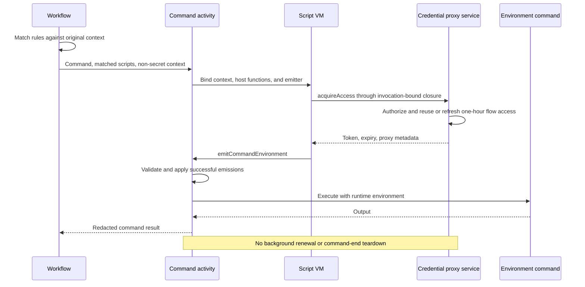

---
intent_links:
  - intent: "#configuration"
    code:
      - common/repo_config.go
      - common/credential_proxy_config.go
      - side.yml
  - intent: "#execution"
    code:
      - env/environment.go
      - dev/run_command.go
      - dev/run_tests.go
      - worker/worker.go
  - intent: "#credential-proxy-access"
    code:
      - credential_proxy/authorization.go
      - credential_proxy/provisioning.go
      - credential_proxy/server/control.go
      - credential_proxy/server/flow_activation.go
---

# Command script hooks

## Problem

Commands need extensible worker-side preparation, including access to host
credential proxies, without introducing a separate command activity for each
integration. Scripts connect reusable host operations to event-specific effects.
Provider credentials remain on the host.

This specification extends [Lifecycle hooks](hooks.md) with a `script` action
and a `before_command` event. Its per-command event extends the base design's
batch-only event scope. Hook actions do not recursively emit command events.

## Requirements

- The ordinary `env.EnvRunCommandActivity` executes commands. It supports
  generic hooks without depending on credential-proxy behavior.
- Workflow code matches rules once against the original event context.
  Matching actions execute serially inside the command activity.
- Scripts execute in a worker-side goja VM with explicitly exposed host
  functions. They have no implicit filesystem, process, network, or Go access.
- Script return values are ignored. Event-specific functions explicitly emit
  effects; scripts can perform allowed work without emitting anything.
- Scripts and serialized inputs contain no runtime credentials. Runtime
  environment additions never become separate activity results.
- Credential-proxy access retains flow-scoped reuse and one-hour leases.
  Commands require neither background renewal nor command-end cleanup.

## Configuration

Named proxy definitions remain under top-level `credential_proxies`. Hook rules
select when commands receive access. Environment-specific `credential_proxies`
activation lists are replaced by hook matching.

```yaml
credential_proxies:
  openai-api:
    auth:
      side:
        provider: openai
        auth_type: api
  openai-subscription:
    auth:
      side:
        provider: openai
        auth_type: subscription

hooks:
  before_command:
    - match:
        env_types: [modal]
      actions:
        - type: script
          source: |
            const access = host.credentialProxies.acquireAccess({
              names: ["openai-api", "openai-subscription"],
            });

            emitCommandEnvironment({
              envVars: {
                SIDE_CREDENTIAL_PROXY_TOKEN: access.token,
                SIDE_CREDENTIAL_PROXIES: JSON.stringify(access.proxies),
              },
            });
```

`source` contains a JavaScript function body. Scripts receive a data-only
`context` snapshot, including `envType` and non-secret repository configuration
under `repoConfig`, using camelCase property names.

Existing reverse-port-forward configuration supplies connectivity. Scripts do
not repeat ports or select arbitrary upstream URLs. Trusted host-local proxy
authorization and development-mode policy remain authoritative.

## Execution

`before_command` runs after environment readiness and before the approved command
executes. Its scripts run inside the ordinary command activity, not in separate
activities that return runtime values through workflow history. Activity retries
can execute hooks again.

Each action has a fresh VM and an invocation-local set of host bindings.
Bindings are closures capturing the activity context and required invocation
data. Shared access reuse belongs outside the VM. No credential-proxy-specific
command activity or command-activity factory is required.

The `script` action follows the lifecycle-hook timeout and error rules.
Cancellation interrupts JavaScript execution and propagates into host operations.
VM interruption alone does not cancel a Go host function; every exposed operation
must honor the activity/action context.

Command scripts may call:

```typescript
emitCommandEnvironment({
  envVars: Record<string, string>,
}): void;
```

The emitter is an event-specific binding, not a general script return convention.
Names and string values are validated before acceptance. Scripts may emit zero
or more additions. Emissions are staged until the action succeeds; a failed
action contributes no additions, including when configured to warn and proceed.
External side effects are not rolled back.

Successful additions compose in action and emission order, with later assignments
winning collisions. They augment command variables without bypassing normal
environment setup, changing environment identity, rematching hooks, or altering
the approved command.

## Credential-proxy access

The reusable host operation is:

```typescript
host.credentialProxies.acquireAccess({
  names: string[],
}): {
  token: string;
  expiresAt: string;
  proxies: Record<string, {
    url: string;
    upstream: string;
    side?: {
      provider: string;
      profile: string;
      authType: string;
      configuredAuthType: string;
    };
  }>;
};
```

`expiresAt` is an RFC 3339 timestamp. `proxies` uses the metadata format consumed
by credential-proxy clients. Access acquisition returns access data, not a
command environment. Scripts decide whether and how to emit that data.

The binding captures the activity context, original configuration, forwarded-port
mapping, workspace identity, and workflow identity. Scope and context are not
JavaScript arguments. Script mutations cannot change the trusted invocation data.

Flow scope is the workspace ID plus Temporal workflow ID, not the workflow run
ID, activity ID, or retry attempt. Workflow identity is obtained from activity
execution metadata; required workspace identity travels as non-secret invocation
metadata. Non-Temporal callers must supply an explicit equivalent identity.

Acquisition authorizes the selected definitions against trusted host configuration.
It reuses valid access or obtains refreshed access before command execution.
Refreshing an authorized flow lease may retain the same bearer token and extend
its expiry by one hour; renewal does not imply rotation. Different definitions or
flows cannot share broader access through a cache hit.

The proxy service remains available across commands and flows. Commands do not
start or tear it down, revoke access on completion, or renew access in the
background. Expiry remains enforced for subsequent requests.

## Security

- Provider credentials are never returned to scripts or remote commands.
- Capability tokens authorize only the selected, host-approved proxies.
- Host bindings track returned tokens for redaction immediately, even if a
  script fails before emitting an environment.
- All emitted environment values are treated as sensitive. Script diagnostics,
  exceptions, command output, and errors are redacted before logging,
  truncation, or inclusion in workflow results.
- Emission is not a way to publish secrets through workflow payload updates.
- Repository scripts are trusted automation with restricted host capabilities,
  not a general security sandbox for hostile JavaScript.
- Unknown action fields, invalid script configuration, malformed emissions, and
  unavailable host operations fail explicitly.

## Flow



See also [Credential Proxy](credential_proxy.md) for upstream authentication,
streaming, and tunnel requirements.