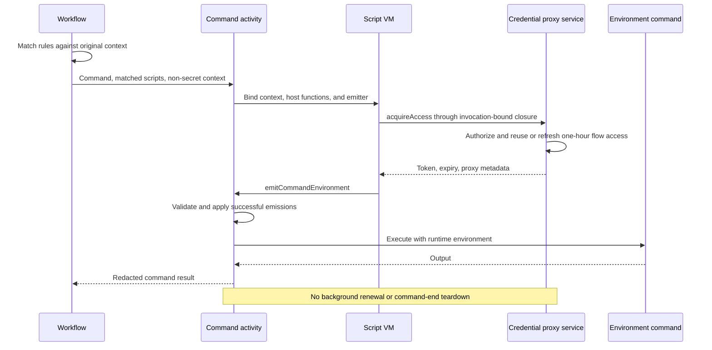

---
intent_links:
  - intent: "#configuration"
    code:
      - common/repo_config.go
      - common/credential_proxy_config.go
      - side.yml
  - intent: "#execution"
    code:
      - scripting/runner.go
      - scripting/command.go
      - scripting/runner_test.go
      - scripting/command_test.go
  - intent: "#standalone-api-and-redaction-handoff"
    code:
      - scripting/data.go
      - scripting/redactor.go
      - scripting/runner.go
      - scripting/command.go
      - credential_proxy/access/access.go
      - go.mod
      - go.sum
  - intent: "#credential-proxy-access"
    code:
      - credential_proxy/access/access.go
      - credential_proxy/access/access_test.go
      - credential_proxy/authorization.go
      - credential_proxy/provisioning.go
      - credential_proxy/server/control.go
      - credential_proxy/server/flow_activation.go
  - intent: "#security"
    code:
      - scripting/redactor.go
      - credential_proxy/policy.go
      - api/credential_proxy.go
      - api/credential_proxy_test.go
      - credential_proxy/server/service.go
---

# Command script hooks

## Problem

Commands need extensible worker-side preparation, including access to host
credential proxies, without introducing a separate command activity for each
integration. Scripts connect reusable host operations to event-specific effects.
Provider credentials remain on the host.

This specification extends [Lifecycle hooks](hooks.md) with a `script` action
and a `before_command` event. Its per-command event extends the base design's
batch-only event scope. Hook actions do not recursively emit command events.

## Implementation status

The standalone goja runner, transactional command-environment emissions,
invocation-bound credential-proxy access, shared redaction support, and focused
component tests are implemented. The compatible goja revision is pinned in
`go.mod` and `go.sum`. Proxy startup and Side credential access are
configuration-driven, independent of development mode.

Hook configuration, matching, dispatch, command-activity integration, command
output redaction wiring, and `side.yml` activation migration remain deferred to
the parallel hooks work. Existing command wrappers, provisioners, worker
registrations, workflow compatibility paths, and legacy keepalive plumbing
remain in use pending that integration and subsequent cleanup.

The configuration example, command-activity execution, and sequence diagram
below describe the target integration, not an already wired command path.
[PLAN.md](../../PLAN.md) tracks only remaining work.

## Requirements

- The ordinary `env.EnvRunCommandActivity` executes commands. It supports
  generic hooks without depending on credential-proxy behavior.
- Workflow code matches rules once against the original event context.
  Matching actions execute serially inside the command activity.
- Scripts execute in a worker-side goja VM with explicitly exposed host
  functions. They have no implicit filesystem, process, network, or Go access.
- Script return values are ignored. Event-specific functions explicitly emit
  effects; scripts can perform allowed work without emitting anything.
- Scripts and serialized inputs contain no runtime credentials. Runtime
  environment additions never become separate activity results.
- Credential-proxy access retains flow-scoped reuse and one-hour leases.
  Commands require neither background renewal nor command-end cleanup.

## Configuration

Named proxy definitions remain under top-level `credential_proxies`. Hook rules
select when commands receive access. Environment-specific `credential_proxies`
activation lists are replaced by hook matching.

```yaml
credential_proxies:
  openai-api:
    auth:
      side:
        provider: openai
        auth_type: api
  openai-subscription:
    auth:
      side:
        provider: openai
        auth_type: subscription

hooks:
  before_command:
    - match:
        env_types: [modal]
      actions:
        - type: script
          source: |
            const access = host.credentialProxies.acquireAccess({
              names: ["openai-api", "openai-subscription"],
            });

            emitCommandEnvironment({
              envVars: {
                SIDE_CREDENTIAL_PROXY_TOKEN: access.token,
                SIDE_CREDENTIAL_PROXIES: JSON.stringify(access.proxies),
              },
            });
```

`source` contains a JavaScript function body. Scripts receive a data-only
`context` snapshot, including `envType` and non-secret repository configuration
under `repoConfig`, using camelCase property names.

Existing reverse-port-forward configuration supplies connectivity. Scripts do
not repeat ports or select arbitrary upstream URLs. Retain the existing host
22855 to container 32855 credential-proxy reverse forward and ordinary forwards
when migrating activation lists.

The host service independently loads and merges host user configuration and its
startup repository configuration. Repository definitions may expand authorized
access through that service-loaded configuration; conflicting definitions are
rejected. Arbitrary definitions supplied by scripts or activation requests do not
become trusted. Requested definitions must match the service-loaded definitions.

Startup requires at least one configured, permitted proxy. `SIDE_APP_ENV` does
not gate startup or access. `SIDE_CREDENTIAL_PROXY_SIDE_AUTH_ENABLED=false`
remains an emergency host-side opt-out for Sidekick-managed credentials; generic
environment-variable and command credential sources are unaffected. Private
host control access, scoped bearer-token authentication, and expiry remain
authoritative.

## Execution

`before_command` runs after environment readiness and before the approved command
executes. Its scripts run inside the ordinary command activity, not in separate
activities that return runtime values through workflow history. Activity retries
can execute hooks again.

Each action has a fresh VM and an invocation-local set of host bindings.
Bindings are closures capturing the activity context and required invocation
data. Shared access reuse belongs outside the VM. No credential-proxy-specific
command activity or command-activity factory is required.

The `script` action follows the lifecycle-hook timeout and error rules.
Cancellation interrupts JavaScript execution and propagates into host operations.
VM interruption alone does not cancel a Go host function; every exposed operation
must honor the activity/action context.

Command scripts may call:

```typescript
emitCommandEnvironment({
  envVars: Record<string, string>,
}): void;
```

The emitter is an event-specific binding, not a general script return convention.
Names and string values are validated before acceptance. Scripts may emit zero
or more additions. Emissions are staged until the action succeeds; a failed
action contributes no additions, including when configured to warn and proceed.
External side effects are not rolled back.

Successful additions compose in action and emission order, with later assignments
winning collisions. They augment command variables without bypassing normal
environment setup, changing environment identity, rematching hooks, or altering
the approved command.

## Standalone API and redaction handoff

The reusable Go API is independent of hook configuration and command lifecycle:

- `scripting.Run(parent, scripting.Input{...})` executes `Source` as a JavaScript
  function body in a fresh VM and ignores its return value. `Context` must be
  non-secret data. It is detached before exposure; struct fields use camelCase
  JSON/TOML names while user-defined dictionary keys remain unchanged.
  `scripting.Snapshot(value)` also exposes this data-only conversion explicitly.
  Snapshotting is not secret removal: the caller must exclude credentials.
- `Input.Host` installs `host.<namespace>.<operation>` and `Input.Functions`
  installs explicit event-specific globals. Each `scripting.Operation` takes
  `(context.Context, json.RawMessage)` and returns `(any, error)`. Operations
  receive the bounded action context, must honor cancellation, and return only
  data. There is no implicit filesystem, process, network, Go capability, plugin
  loader, or general module system.
- `Input.Timeout` defaults to 30 seconds when zero and is bounded by the parent
  context; negative durations fail. Hook configuration must validate positive
  `timeout_seconds`. Cancellation interrupts JavaScript and reaches host calls.
  Public errors retain `errors.Is` classification for cancellation/deadline
  expiry without exposing secret-bearing underlying errors.
- `scripting.RunCommand(parent, input)` additionally installs
  `emitCommandEnvironment`. Its `CommandResult.EnvVars` contains assignments
  only on success and is excluded from JSON serialization. Call
  `result.ApplyTo(envVars)` on a non-nil destination map for successful actions
  in dispatch order. The runner does not implement fail/warn policy, retries,
  matching, command approval, or command execution.
- `access.New(invocationCtx, access.Input{RepoConfig, WorkspaceID, WorkflowID,
  Socket}, redactor)` from `credential_proxy/access` captures trusted invocation
  data. Pass its `binding.Host()` as `scripting.Input.Host`. The optional
  `Socket` defaults to the private host control socket. Temporal activity
  metadata supplies workflow identity; `WorkflowID` is required outside
  Temporal and ignored inside an activity.
- `binding.Acquire(actionCtx, names)` exposes the same operation directly to Go
  callers. It is bounded by both the action and captured invocation contexts.
  Its token, RFC 3339 expiry, and client metadata are runtime-only values, not
  activity results.

Create one `&scripting.Redactor{}` for the invocation and pass that same pointer
to `access.New` and every `scripting.Input`. Custom host operations must call
`redactor.Add(secret)` before a secret can escape, even on later failure. The
access binding records returned tokens before validating the lease or metadata.
The emitter records supplied environment values even when an action fails and
its assignments are discarded.

Console diagnostics are buffered and redacted with the values learned during
the action before truncation and publication. Runner results expose safe
diagnostics and duration; errors are also redacted before publication. Callers
must preserve the shared redactor through subsequent actions and command output
handling, using `redactor.Redact` on stdout, stderr, and errors before logging,
truncation, or serialization. Connecting this callback to command execution is
deferred; the standalone API does not perform that integration.

Keep access results, environment assignments, and redaction state inside the
activity/invocation. JSON exclusion of `CommandResult.EnvVars` is not permission
to serialize other secret-bearing values: never place them in Temporal
inputs/results or log an access result.

## Credential-proxy access

The reusable host operation is:

```typescript
host.credentialProxies.acquireAccess({
  names: string[],
}): {
  token: string;
  expiresAt: string;
  proxies: Record<string, {
    url: string;
    upstream: string;
    side?: {
      provider: string;
      profile: string;
      authType: string;
      configuredAuthType: string;
    };
  }>;
};
```

`expiresAt` is an RFC 3339 timestamp. `proxies` uses the metadata format consumed
by credential-proxy clients. Access acquisition returns access data, not a
command environment. Scripts decide whether and how to emit that data.

`names` must be a nonempty array of configured proxy names. Duplicate names are
normalized. Empty selections, unknown names, malformed arguments, missing
forwarding, and unavailable or denied control operations fail explicitly.
Scripts cannot supply configuration, scope, identity, or forwarding overrides.

The binding captures the activity context, original configuration, forwarded-port
mapping, workspace identity, and workflow identity. Scope and context are not
JavaScript arguments. Script mutations cannot change the trusted invocation data.

Flow scope is the workspace ID plus Temporal workflow ID, not the workflow run
ID, activity ID, or retry attempt. Workflow identity is obtained from activity
execution metadata; required workspace identity travels as non-secret invocation
metadata. Non-Temporal callers must supply an explicit equivalent identity.

Each acquisition calls the private control service's flow activation endpoint,
which reauthorizes selected definitions against independently loaded host user
and startup-repository configuration before reuse. Valid access retains its
bearer token while extending expiry by one hour. Missing, revoked, expired, or
restarted-service access is replaced on acquisition. Different definitions or
flows cannot share broader access through a cache hit.

The access binding has no client cache, background renewal, command-end
revocation, or service teardown. The proxy service remains available across
commands and flows, and expiry remains enforced for subsequent requests. The
target command integration acquires access before use; still-used legacy
command lease plumbing is removed only after that integration lands.

## Security

- Provider credentials are never returned to scripts or remote commands.
- Capability tokens authorize only the selected, host-approved proxies.
- Host bindings track returned tokens for redaction immediately, even if a
  script fails before emitting an environment.
- All emitted environment values are treated as sensitive. Script diagnostics,
  exceptions, command output, and errors are redacted before logging,
  truncation, or inclusion in workflow results.
- Emission is not a way to publish secrets through workflow payload updates.
- Repository scripts are trusted automation with restricted host capabilities,
  not a general security sandbox for hostile JavaScript.
- Unknown action fields, invalid script configuration, malformed emissions, and
  unavailable host operations fail explicitly.

## Flow



See also [Credential Proxy](credential_proxy.md) for upstream authentication,
streaming, and tunnel requirements.