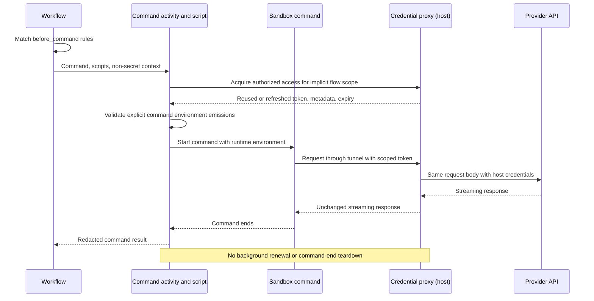

---
intent_links:
  - intent: "#access-and-configuration"
    code:
      - common/credential_proxy_config.go
      - credential_proxy/authorization.go
      - credential_proxy/policy.go
      - api/credential_proxy.go
      - common/local_config.go:LocalConfig
      - common/repo_config.go:RepoConfig
      - side.yml
  - intent: "#security"
    code:
      - credential_proxy/auth.go
      - credential_proxy/source.go
      - credential_proxy/server/proxy.go
      - credential_proxy/server/capabilities.go
      - credential_proxy/server/control.go
      - credential_proxy/server/service.go
      - credential_proxy/server/socket.go
  - intent: "#provider-behavior"
    code:
      - credential_proxy/provisioning.go
      - credential_proxy/llmproxy/provider.go
      - credential_proxy/server/binding.go
      - credential_proxy/server/side.go
      - persisted_ai/llm2_activities.go:Stream
  - intent: "#flow"
    code:
      - credential_proxy/server/activation.go
      - credential_proxy/server/flow_activation.go
      - env/environment.go
      - dev/run_command.go:RunCommand
      - dev/run_tests.go
---
# Credential Proxy

## Problem

Development commands in remote environments need real provider credentials for
LLM inference, testing, and debugging. Those credentials belong on the host
running the Sidekick API server and worker, not in remote environments.

The credential proxy lets a sandbox use authorized host credentials without
receiving them. The host retains responsibility for secret storage and OAuth
refresh.

## Requirements

### Access and configuration

- Trusted host configuration authorizes named proxies, their upstream
  destinations, and their credential sources. Repository definitions cannot
  expand that authorization.
- Repository `before_command` hook rules select when commands receive access,
  including automatically for Modal. Rules replace environment-specific proxy
  activation lists; named definitions remain under `credential_proxies`.
- Scripts acquire access through a reusable host operation and explicitly emit
  command environment additions. The sandbox receives proxy addresses, a scoped
  access token, and the metadata needed to select and use them.
- Existing reverse-port-forward configuration supplies connectivity. Scripts
  do not choose arbitrary destinations or repeat forwarding configuration.
- Sidekick-managed credentials are available only in development
  (`SIDE_APP_ENV=development`). This access is enabled by default there and can
  be disabled. Explicitly configured environment-variable and command-based
  credential sources are not subject to the development-only restriction.
- No listener starts when all configured proxies are prohibited by policy.

### Security

- Provider credentials remain on the host. They are neither supplied to scripts
  or the sandbox nor logged.
- A random bearer token authorizes one flow to use only its activated proxies.
  Scope is the workspace ID plus workflow ID, not a run ID, activity ID, or
  retry attempt. Invocation-bound host functions supply this identity implicitly;
  scripts cannot select or override it.
- Flow access has a one-hour lease. Before command execution, acquisition reuses
  valid access or refreshes expired or near-expiry access. Refresh rechecks host
  authorization and may retain the token while extending expiry by one hour.
  Token rotation is not required for lease renewal.
- Commands recover lost or revoked access before starting, including after a
  proxy restart. Acquisition failure follows the hook's failure policy and
  supplies no command environment additions.
- There is no background keepalive or command-end revocation. The shared proxy
  service remains available across commands and flows; expiry continues to be
  enforced for subsequent requests.
- Runtime tokens remain outside workflow inputs and results. Acquired tokens
  are tracked for redaction even if a script fails before emitting anything.
  All emitted environment values are treated as sensitive. Script diagnostics,
  exceptions, command output, and errors are redacted before logging,
  truncation, or inclusion in workflow results.
- Proxy authentication is separate from upstream authentication. The proxy
  removes caller credentials and identity headers, attaches host credentials,
  and never forwards the proxy token upstream.
- Requests can reach only configured upstreams. Callers cannot choose arbitrary
  destinations or escape an upstream's base path. The proxy does not follow
  upstream redirects.
- The proxy listens on loopback and is reached through the existing reverse
  tunnel. Access administration remains private to the host; tunnel access
  alone does not authorize requests.

### Provider behavior

- OpenAI Responses supports both subscription OAuth and API-key authentication.
  Credential lookup and OAuth refresh use Sidekick's existing secret management.
- Proxy selection respects the requested provider, profile, and authentication
  mode. When either mode is allowed, the host resolves the mode before the
  sandbox makes requests, so subscription and API requests retain their
  respective semantics. Ambiguous selections are rejected.
- Request bodies and streaming responses pass through unchanged, including
  usage and completion events. Responses stream as they arrive, and caller
  cancellation cancels the upstream request.
- Without proxy provisioning, ordinary credential lookup and provider behavior
  remain unchanged. Invalid provisioning or a missing matching proxy fails
  closed for calls routed through the proxy; sandbox credentials are not a
  fallback. Unrelated provider endpoints remain unaffected.
- Credential-proxy authentication and provider rebinding remain outside `llm2`
  and `env`. Additional providers fit the same design without making either
  package aware of credential proxies.

## Flow

Workflow code matches hook rules against the original invocation context. The
ordinary command activity runs the selected scripts through generic hook support.
An invocation-bound host function captures activity context, configuration,
forwarding, and flow identity to acquire authorized proxy access.

Access acquisition returns a token, expiry, and proxy metadata, not a command
environment. The script calls `emitCommandEnvironment` to supply command
variables; script return values are ignored. Validated emissions are applied
only when the action succeeds and remain activity-local.

The sandbox calls through the reverse tunnel. The proxy authenticates the
caller and uses host credentials for the upstream request. Ending the command
neither revokes the flow's access nor tears down the proxy.

See [Lifecycle hooks](hooks.md) and
[Command script hooks](command_script_hooks.md) for matching, script execution,
host operations, and environment emission.