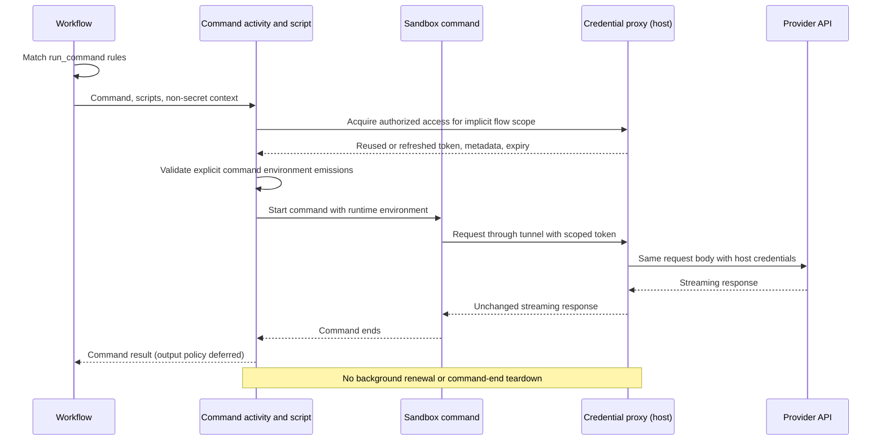

---
intent_links:
  - intent: "#access-and-configuration"
    code:
      - common/credential_proxy_config.go
      - credential_proxy/access/access.go
      - credential_proxy/access/access_test.go
      - credential_proxy/authorization.go
      - credential_proxy/policy.go
      - credential_proxy/policy_test.go
      - api/credential_proxy.go
      - api/credential_proxy_test.go
      - common/local_config.go:LocalConfig
      - common/repo_config.go:RepoConfig
      - side.yml
  - intent: "#security"
    code:
      - credential_proxy/auth.go
      - credential_proxy/source.go
      - credential_proxy/server/proxy.go
      - credential_proxy/server/capabilities.go
      - credential_proxy/server/control.go
      - credential_proxy/server/service.go
      - credential_proxy/server/socket.go
  - intent: "#provider-behavior"
    code:
      - credential_proxy/provisioning.go
      - credential_proxy/llmproxy/provider.go
      - credential_proxy/server/binding.go
      - credential_proxy/server/side.go
      - persisted_ai/llm2_activities.go:Stream
  - intent: "#flow"
    code:
      - credential_proxy/access/access.go
      - credential_proxy/server/activation.go
      - credential_proxy/server/flow_activation.go
      - credential_proxy/server/flow_activation_test.go
      - credential_proxy/server/flow_control_test.go
      - credential_proxy/access/hook_script_host.go:HookScriptHost
      - scripting/command.go
---
# Credential Proxy

## Problem

Development commands in remote environments need real provider credentials for
LLM inference, testing, and debugging. Those credentials belong on the host
running the Sidekick API server and worker, not in remote environments.

The credential proxy lets a sandbox use authorized host credentials without
receiving them. The host retains responsibility for secret storage and OAuth
refresh.

## Implementation status

Configuration-driven startup/access and the standalone invocation-bound
`credential_proxy/access` operation are implemented. The `scripting` runner
supports transactional emissions; automatic output masking is deferred.
[Command script hooks](command_script_hooks.md#standalone-api)
documents their Go API and caller responsibilities.

Hook schema, matching, dispatch, command-activity integration, and the
`side.yml` migration to a `hooks.run_command` script rule are implemented. The
legacy command wrappers, provisioners, worker registrations, workflow
compatibility paths, and command keepalive have been removed. Command-output
policy (masking of hook-emitted values) remains deferred.

## Requirements

### Access and configuration

- The host service independently loads and merges host user configuration and
  its startup repository configuration to authorize named proxies, upstreams,
  and credential sources. Repository definitions may expand authorization when
  loaded by the service. Conflicting definitions fail. Arbitrary script/request
  definitions are not trusted: activation must match service-loaded definitions,
  and activation/renewal reload authorization.
- Repository `run_command` hook rules select when commands receive access,
  including automatically for Modal. Rules replace environment-specific
  activation lists; named definitions remain under `credential_proxies`.
- Scripts acquire access through a reusable host operation and explicitly emit
  command environment additions. Acquisition returns only a scoped token,
  RFC 3339 expiry, and client-compatible proxy metadata, not environment
  assignments or provider credentials. Empty selections and malformed arguments
  fail; repeated names are normalized.
- Existing reverse-port-forward configuration supplies connectivity. Scripts
  do not choose arbitrary destinations or repeat forwarding configuration.
  Preserve ordinary forwards and the existing credential-proxy host 22855 to
  container 32855 reverse forward during migration.
- Startup and Sidekick-managed credential access do not depend on
  `SIDE_APP_ENV`. `SIDE_CREDENTIAL_PROXY_SIDE_AUTH_ENABLED=false` remains an
  emergency host-side opt-out for Side sources. Generic environment-variable
  and command-based credential sources are unaffected by that opt-out.
- Startup requires at least one configured, permitted definition. No idle
  listener starts merely because development mode is enabled; unconfigured or
  entirely prohibited definitions require no control socket/cache setup.

### Security

- Provider credentials remain on the host. They are neither supplied to scripts
  or the sandbox nor logged.
- A random bearer token authorizes one flow to use only its activated proxies.
  Scope is the workspace ID plus workflow ID, not a run ID, activity ID, or
  retry attempt. Invocation-bound host functions supply this identity implicitly;
  scripts cannot select or override it.
- Flow access has a one-hour lease. Every acquisition invokes server-side flow
  activation and rechecks authorization before reuse. A valid lease retains its
  token and extends expiry by one hour. Missing, revoked, expired, or
  restarted-service access is replaced before use. Different flows or selected
  definitions remain isolated.
- The binding captures original configuration, forwarding, and workspace plus
  workflow identity. Temporal activity metadata supplies the workflow ID;
  non-Temporal callers must supply an explicit equivalent identity. Acquisition
  honors both invocation and action cancellation.
- The standalone binding has no cache, background keepalive, command-end
  revocation, or service teardown. The shared proxy service remains available
  across commands and flows; expiry remains enforced for subsequent requests.
  Legacy command lease plumbing remains until hook integration replaces it.
- Runtime tokens must remain outside workflow inputs and results. The standalone
  runner and access binding do not track secrets or mask output. Automatic
  masking is deferred to invocation/logging integration, which must apply any
  such policy before truncation or persistence for Go and JavaScript alike.
- Hook dispatch must apply fail/warn policy without accepting failed-action
  assignments and must always propagate cancellation.
- Proxy authentication is separate from upstream authentication. The proxy
  removes caller credentials and identity headers, attaches host credentials,
  and never forwards the proxy token upstream.
- Requests can reach only configured upstreams. Callers cannot choose arbitrary
  destinations or escape an upstream's base path. The proxy does not follow
  upstream redirects.
- The proxy listens on loopback and is reached through the existing reverse
  tunnel. Access administration remains private to the host; tunnel access
  alone does not authorize requests.

### Provider behavior

- OpenAI Responses supports both subscription OAuth and API-key authentication.
  Credential lookup and OAuth refresh use Sidekick's existing secret management.
- Proxy selection respects the requested provider, profile, and authentication
  mode. When either mode is allowed, the host resolves the mode before the
  sandbox makes requests, so subscription and API requests retain their
  respective semantics. Ambiguous selections are rejected.
- Request bodies and streaming responses pass through unchanged, including
  usage and completion events. Responses stream as they arrive, and caller
  cancellation cancels the upstream request.
- Without proxy provisioning, ordinary credential lookup and provider behavior
  remain unchanged. Invalid provisioning or a missing matching proxy fails
  closed for calls routed through the proxy; sandbox credentials are not a
  fallback. Unrelated provider endpoints remain unaffected.
- Credential-proxy authentication and provider rebinding remain outside `llm2`
  and `env`. Additional providers fit the same design without making either
  package aware of credential proxies.

## Flow

Workflow code matches hook rules against the original invocation context. The
ordinary command activity runs the selected scripts through generic hook support.
An invocation-bound host function captures activity context, configuration,
forwarding, and flow identity to acquire authorized proxy access.
`access.HookScriptHost` supplies it to the command activity as an
`env.HookScriptHostProvider`, exposing `host.credentialProxies.acquireAccess`.

Access acquisition returns a token, expiry, and proxy metadata, not a command
environment. The script calls `emitCommandEnvironment` to supply command
variables; script return values are ignored. Validated emissions are applied
only when the action succeeds and remain activity-local.

The sandbox calls through the reverse tunnel. The proxy authenticates the
caller and uses host credentials for the upstream request. Ending the command
neither revokes the flow's access nor tears down the proxy.

See [Lifecycle hooks](hooks.md) and
[Command script hooks](command_script_hooks.md) for matching, script execution,
host operations, and environment emission.